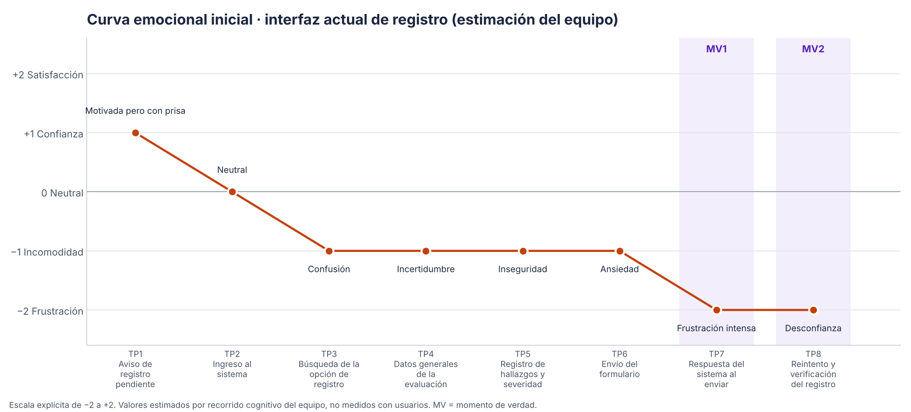

# Diagnóstico UX · Registro de evaluaciones UX

> Fase 1 (35 min) · Responsable: **Integrante 1** · Issues: #1, #2, #3, #4, #5
> Fuentes conceptuales: curva emocional, touchpoints y momentos de verdad ([juANO2202/HCI-2026-G1](https://github.com/juANO2202/HCI-2026-G1)); heurísticas de Nielsen y escala de severidad 0–4.

## 1. Caso asignado

| Elemento | Definición |
|---|---|
| **Sistema actual** | *SGA-LAB v3.2*, módulo de procesos del laboratorio donde se registran las evaluaciones UX (reconstruido en [`evidencias/interfaz-original/`](evidencias/interfaz-original/index.html)). |
| **Persona** | **Valeria Núñez**, 22 años, estudiante de Software y evaluadora auxiliar del Laboratorio de Usabilidad. Conoce las heurísticas de Nielsen. Tiene tendinitis en la muñeca derecha y usa sobre todo el **teclado** (Tab, Enter, flechas). Trabaja en una laptop de 14″. |
| **Contexto** | Al terminar una sesión de evaluación de la *App Biblioteca FISEI* debe registrar en el sistema los datos de la sesión y los hallazgos (heurística incumplida, severidad, descripción y ubicación) para que el docente los califique. |
| **Tarea crítica** | Registrar una evaluación heurística con 3 hallazgos y obtener la constancia de que quedó registrada. |
| **Restricción** | El registro cierra a las **18:00**; la Wi-Fi del laboratorio se corta de forma intermitente. |
| **Fallo adicional** | Si la sesión expira (15 min) o se corta la red al pulsar *Grabar*, el sistema muestra «ERROR 500» y **borra todo el formulario**. |

> ⚠️ Si el docente les entregó en privado otra persona, restricción o fallo, reemplacen esta tabla con esos datos y ajusten las filas afectadas de la curva y de los problemas. Lo demás del diseño no cambia.

## 2. Tareas de prueba (T1–T3)

| ID | Tarea | Criterio de éxito | Relación |
|---|---|---|---|
| **T1** Localizar | «Encuentra dónde se registra una evaluación nueva.» | Llega al paso 1 del registro sin ayuda. | R1 |
| **T2** Operar / corregir | «Registra la evaluación de la App Biblioteca FISEI con estos 3 hallazgos (tarjeta de datos). Si el sistema marca un error, corrígelo.» | Llega a la revisión con 3 hallazgos válidos; corrige al menos un error sin perder datos. | R2, R3, R4, R5 |
| **T3** Finalizar / confirmar | «Envía la evaluación y dime cómo sabes que quedó registrada.» | Obtiene la confirmación con código; si el envío falla, se recupera y reintenta. | R5, R6 |

## 3. Problemas priorizados (interfaz actual)

Severidad según la escala de Nielsen (0 sin problema · 1 cosmético · 2 menor · 3 mayor · 4 catastrófico). Evidencia: capturas en [`evidencias/capturas/original-*.png`](evidencias/capturas/).

| Prioridad | Problema | Heurística(s) | Sev. | Momento | Issue |
|---|---|---|---|---|---|
| **P1** | Al fallar el envío (red o sesión), el sistema **borra todo** lo escrito. | H9 Recuperarse de errores · H5 Prevención de errores | **4** | TP7 · **MV1** | #1 |
| **P2** | La opción de registro está escondida en *Procesos ▸ Formularios ▸ FRM-EV-02*, con un código que no significa nada para el usuario. | H2 Relación con el mundo real · H6 Reconocer antes que recordar | **3** | TP3 | #2 |
| **P3** | El error es genérico («ERROR 500: Datos inválidos»), aparece arriba y no dice qué campo falla ni cómo corregirlo; no hay indicador mientras se graba. | H9 · H1 Visibilidad del estado | **3** | TP6–TP7 | #3 |
| **P4** | Tras grabar con éxito vuelve al inicio **sin confirmación ni código**: el usuario no sabe si quedó registrado. | H1 Visibilidad del estado del sistema | **3** | TP8 · **MV2** | #4 |
| **P5** | Formulario único y denso: marcadores de posición en lugar de etiquetas, códigos (EH/PU/RC), fecha aaaa/dd/mm, severidad en texto libre, sin foco visible, bajo contraste. | H4 Consistencia y estándares · H8 Diseño minimalista · WCAG 2.4.7, 3.3.2, 1.4.3 | **2** | TP4–TP5 | #5 |

**Heurísticas examinadas en el diagnóstico:** H1, H2, H4, H5, H6, H8, H9 (mínimo exigido: 3).
**Heurísticas que se observarán en la prueba:** H1, H5 y H9 (ver [`pruebas/protocolo.md`](pruebas/protocolo.md)).

## 4. Recorrido emocional (6–8 touchpoints)

Datos: [`recorrido-emocional.csv`](recorrido-emocional.csv) · Gráfico: [`recorrido-emocional.png`](recorrido-emocional.png)

**Escala explícita:** −2 frustración intensa · −1 incomodidad o duda · 0 neutral · +1 confianza · +2 satisfacción y seguridad.
**Tipo de dato:** *estimación* del equipo mediante recorrido cognitivo de la interfaz actual. No es una medición con usuarios.

| TP | Touchpoint | Emoción | Valor | Momento de verdad |
|---|---|---|---|---|
| TP1 | Aviso de registro pendiente (correo con plazo 18:00) | Motivada pero con prisa | +1 | |
| TP2 | Ingreso al sistema | Neutral | 0 | |
| TP3 | Búsqueda de la opción de registro | Confusión | −1 | |
| TP4 | Datos generales de la evaluación | Incertidumbre | −1 | |
| TP5 | Registro de hallazgos y severidad | Inseguridad | −1 | |
| TP6 | Envío del formulario (sin indicador) | Ansiedad | −1 | |
| TP7 | Respuesta del sistema: ERROR 500 y formulario vacío | Frustración intensa | −2 | **MV1 · pérdida de datos** |
| TP8 | Reintento y verificación (sin comprobante) | Desconfianza | −2 | **MV2 · confirmación** |

### Momentos de verdad

- **MV1 (TP7) – El envío falla.** Es el momento que más afecta la confianza: la persona pierde 10–15 minutos de trabajo justo antes del cierre y concluye que el sistema «no es seguro». Todo el diseño posterior gira en evitar esa pérdida (autoguardado, error que conserva datos, reintento).
- **MV2 (TP8) – ¿Quedó registrado?** Sin comprobante, la persona duda, vuelve a enviar o escribe al docente. Una confirmación con código y la posibilidad de ver el registro cierran el ciclo.

## 5. Tres mejoras propuestas (de diagnóstico a diseño)

1. **Nunca perder datos:** autoguardado del borrador, errores que conservan lo escrito y reintento del envío → P1, MV1 (R4, R5).
2. **Acción principal visible y lenguaje del usuario:** botón «Registrar evaluación» en el inicio, asistente de 3 pasos y opciones con nombres en lugar de códigos → P2, P5 (R1, R2, R3).
3. **Retroalimentación en cada paso:** validación en línea junto al campo, estado de carga y confirmación con código de registro → P3, P4, MV2 (R5, R6).

## 6. Issues de diagnóstico

| Issue | Título sugerido | Etiquetas | Asignada a |
|---|---|---|---|
| #1 | P1 · Pérdida total de datos al fallar el envío (sev. 4) | `diagnostico`, `heuristica-H9`, `momento-de-verdad` | Integrante 1 |
| #2 | P2 · Opción de registro escondida tras código FRM-EV-02 (sev. 3) | `diagnostico`, `heuristica-H6` | Integrante 1 |
| #3 | P3 · Error genérico sin campo ni solución (sev. 3) | `diagnostico`, `heuristica-H9` | Integrante 1 |
| #4 | P4 · Sin confirmación tras registrar (sev. 3) | `diagnostico`, `heuristica-H1`, `momento-de-verdad` | Integrante 1 |
| #5 | P5 · Formulario denso, sin etiquetas ni foco visible (sev. 2) | `diagnostico`, `accesibilidad` | Integrante 1 |

Reemplacen los números por los reales que les asigne GitHub.
