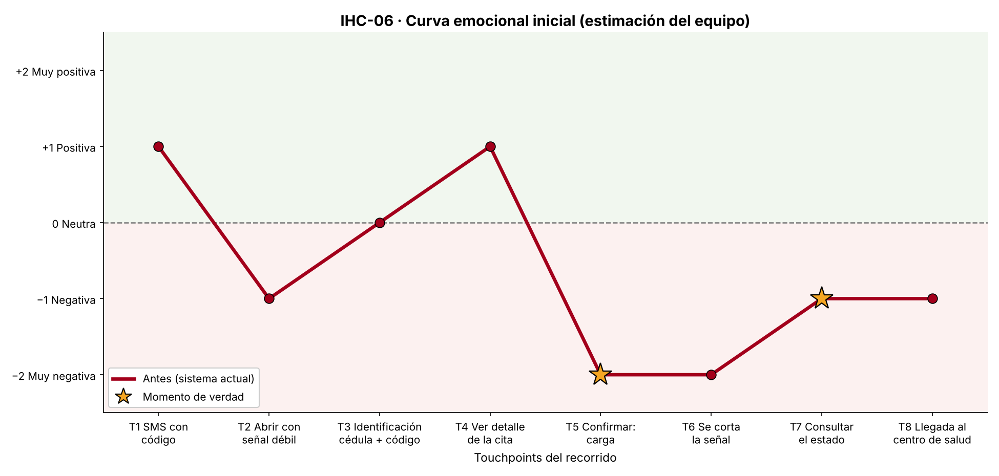

# Fase 1 · Diagnóstico UX · Caso IHC-06

**Responsable:** Carlos Bejarano · **Revisor:** Mario Solis
**Método:** recorrido cognitivo de la tarea crítica y evaluación heurística (Nielsen) hecha por dos integrantes, con severidad de 0 a 4.
**Fuentes de apoyo:** G1 (emoción, touchpoints, momentos de verdad), G2 (requisitos y trazabilidad) y G3 (técnicas de prototipado).

## 1. Tarjeta asignada

| Campo | Valor |
|---|---|
| Código | IHC-06 |
| Variante | C · Citas médicas. Problema inicial: pérdida de datos e incertidumbre al confirmar |
| Persona usuaria | Paciente con conexión intermitente |
| Contexto | Sistema de citas médicas en una situación realista de uso |
| Tarea crítica | Confirmar una cita y consultar su estado |
| Restricción obligatoria | Debe conservar la información ante una desconexión |
| Fallo adicional | La pantalla de carga queda indefinida |

## 2. Proto-persona

> **Aclaración:** es una proto-persona construida por el equipo a partir de la tarjeta. No sale de entrevistas, así que sus datos son supuestos de diseño, no hallazgos.

**Rosa Pilamunga, 41 años.** Comerciante. Vive en una comunidad rural de Tungurahua.
- **Conexión:** celular Android de gama baja con plan prepago. En su casa la señal va y viene; en la plaza mejora. Cuida sus megas.
- **Experiencia digital:** usa WhatsApp y Facebook todos los días y escribe con un dedo.
- **Objetivo:** confirmar la cita del lunes (control de presión). El SMS dice que si no confirma, el turno se libera.
- **Frustraciones:** páginas que se quedan cargando, tener que escribir todo otra vez y no saber si «ya quedó».
- **Comportamiento ante la espera:** si algo tarda, recarga o sale de la página, y a veces pulsa el botón varias veces.

## 3. Touchpoints del recorrido actual (antes del rediseño)

Escala emocional de −2 a +2 (guía de G1). ★ = momento de verdad.

| N.º | Touchpoint | Canal | Qué hace Rosa | Emoción | Por qué | Tipo de dato |
|---|---|---|---|---|---|---|
| T1 | SMS de recordatorio con código | SMS | Lee la fecha y el código | +1 | Mensaje claro con su código | Estimación |
| T2 | Abrir el enlace con señal débil | Web móvil | Espera que cargue | −1 | Pantalla en blanco varios segundos, sin indicación | Estimación |
| T3 | Identificación (cédula + código) | Web móvil | Escribe con un dedo | 0 | Campos sencillos, aunque sin ejemplo de formato | Estimación |
| T4 | Ver el detalle de la cita | Web móvil | Revisa fecha, hora y lugar | +1 | Datos claros | Estimación |
| T5 ★ | Pulsar «Confirmar» → pantalla de carga | Web móvil | Espera… y espera | −2 | **Fallo de la tarjeta:** la ruedita gira sin fin, sin tiempo ni mensaje; no sabe si esperar, salir o volver a pulsar | Estimación |
| T6 | Se corta la señal / recarga | Web móvil | Recarga la página | −2 | **Restricción incumplida:** se pierde lo escrito y tiene que identificarse otra vez; si pulsa de nuevo puede confirmar dos veces | Estimación |
| T7 ★ | Consultar el estado («Mis citas») | Web móvil | Busca si quedó confirmada | −1 | Estado ambiguo («En proceso») y sin hora de actualización | Estimación |
| T8 | Llegada al centro de salud | Presencial | Muestra el celular en ventanilla | −1 | Sin comprobante sin conexión; en ventanilla no encuentran la confirmación | Estimación |

### Momentos de verdad

| ID | Touchpoint | Por qué decide la experiencia |
|---|---|---|
| MV1 | T5 · Confirmar (carga indefinida) | Es la caída más fuerte. Si la espera no termina nunca, Rosa abandona o pulsa varias veces (doble confirmación) y pierde la confianza. |
| MV2 | T7 · Consultar el estado | Es el cierre de la tarea. Si el estado no dice con claridad «confirmada» o «pendiente», Rosa viaja sin saber si la atenderán. Por la regla pico-final, es lo que recordará. |

## 4. Hallazgos (vinculados a las heurísticas de Nielsen)

| ID | Hallazgo | Heurística | Severidad (0–4) | Evidencia | Issue |
|---|---|---|---|---|---|
| HZ-1 | La pantalla de carga no tiene tiempo límite, progreso ni mensaje: queda indefinida cuando la red se cae. | **H1** Visibilidad del estado del sistema | **4** · Catastrófico: no sabe si la tarea se hizo | Recorrido en T5 con red lenta o cortada: la ruedita no termina y no hay opción de cancelar | #1 |
| HZ-2 | La información se pierde al desconectarse o recargar, y reenviar puede duplicar la confirmación. | **H3** Control y libertad del usuario; **H5** Prevención de errores | **3** · Grave | Recorrido en T6: recargar borra cédula y código; el botón «Confirmar» sigue activo durante el envío | #2 |
| HZ-3 | El fallo de red no se explica ni ofrece cómo recuperarse, y el estado de la cita es ambiguo. | **H9** Reconocer, diagnosticar y recuperarse de errores; **H1** | **3** · Grave | Recorrido en T5–T7: no se dice el motivo, no hay «Reintentar» y «En proceso» no distingue «guardado en el teléfono» de «confirmado» | #3 |

## 5. Niveles de respuesta emocional (Norman)

| Nivel | Qué vive Rosa en el sistema actual | Qué debe lograr el rediseño |
|---|---|---|
| Visceral | Pantalla en blanco y ruedita sin fin: ansiedad inmediata («¿se colgó?») | Una pantalla liviana con un indicador de conexión visible y la espera con segundos |
| Conductual | Recarga, pierde lo escrito, vuelve a escribir y pulsa varias veces | Datos guardados en el teléfono, límite de espera, «Reintentar» y un solo envío |
| Reflexivo | «Mejor voy temprano y hago fila»: desconfía del sistema y gasta pasaje y megas | Saber con certeza si su cita está confirmada, con un comprobante que puede mostrar sin señal |

## 6. Curva emocional inicial

**Justificación:** la curva cae en T5 (carga indefinida, el fallo de la tarjeta) y se mantiene baja en T6 (pérdida de datos, la restricción incumplida). En T7 (estado ambiguo) no se recupera. Los únicos puntos positivos son el SMS y el detalle de la cita: la información en sí es buena; el problema es la conexión.

## 7. Medición real frente a estimación

| Dato | Tipo | Cómo se obtuvo |
|---|---|---|
| Emoción por touchpoint (curva inicial) | **Estimación** | Recorrido cognitivo del equipo poniéndose en el lugar de la proto-persona; sin usuarios reales en esta fase |
| Severidad de los hallazgos | **Estimación** | Escala de Nielsen (0–4), con acuerdo entre dos evaluadores |
| Tiempo de espera y límite de 12 s del prototipo | **Medición real** | El prototipo cuenta los segundos de cada espera y corta a los 12 s (visible en pantalla) |
| Contraste de colores del prototipo | **Medición real** | Fórmula de WCAG (tabla en `docs/decisiones.md`) |
| Tiempo, errores, pausas, éxito y si entendió el estado | **Medición real (Fase 4)** | Panel del observador (`?observador=1`) en la sesión con un participante de otro grupo |
| Curva después | **Estimación hasta la prueba** | Se actualiza con lo observado (`diagramas/curvas.csv` → `generar_curvas.py`) |

## 8. Issues abiertos en esta fase

- **#1** Pantalla de carga indefinida (HZ-1)
- **#2** Se pierde la información al desconectarse y riesgo de doble envío (HZ-2)
- **#3** Fallo de red sin explicación ni recuperación; estado ambiguo (HZ-3)

El texto listo para copiar en GitHub está en [`docs/issues.md`](issues.md).
