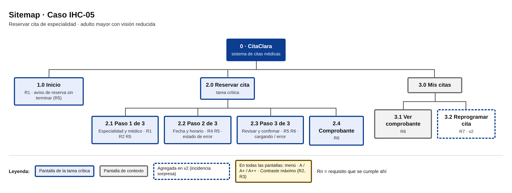
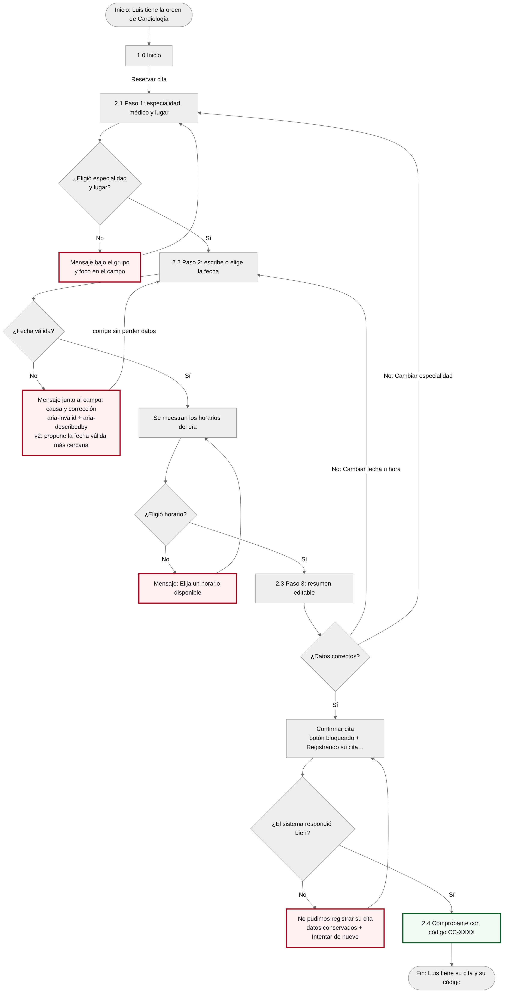

# Fase 2 · Sitemap, navegación y user flow · Caso IHC-05

**Responsable:** Bryan Guatemal · **Revisor:** Karen Molina

## 1. Sitemap

Fuente editable: [`diagramas/sitemap.html`](../diagramas/sitemap.html). Es un sitemap plano: la tarea crítica queda a un clic desde el inicio y la profundidad máxima es 2. Esto sigue la regla de G2 de dejar lo importante a máximo 3 clics.

## 2. Tabla de navegación (de dónde → a dónde → con qué)

| # | De | A | Con qué elemento | Paso del user flow | Regla que cumple |
|---|---|---|---|---|---|
| 1 | Cualquier pantalla | 1.0 / 2.1 / 3.0 | Menú superior; el ítem activo tiene `aria-current="page"` | Todo el recorrido | H1 visibilidad, H4 consistencia |
| 2 | 1.0 Inicio | 2.1 Paso 1 | Botón grande «Reservar cita con especialista» | Inicio → Paso 1 | R1 |
| 3 | 1.0 Inicio | Paso donde quedó | «Continuar la reserva» (si hay borrador) | Retoma el flujo | R5, H3 |
| 4 | 2.1 Paso 1 | 2.2 Paso 2 | «Continuar al paso 2» (solo con datos válidos) | ¿Eligió especialidad y lugar? → Sí | H5 |
| 5 | 2.1 Paso 1 | Se queda | Mensaje bajo el grupo, resumen de errores y foco en el campo | → No | H9, R4 |
| 6 | 2.2 Paso 2 | 2.1 Paso 1 | «Volver al paso 1» (los datos se conservan) | Regreso | H3, R5 |
| 7 | 2.2 Paso 2 | Se queda | Mensaje de fecha junto al campo; en v2 también «Usar la fecha …» | ¿Fecha válida? → No | H9, H5, R4 |
| 8 | 2.2 Paso 2 | 2.3 Paso 3 | «Continuar al paso 3» | ¿Eligió horario? → Sí | R1 |
| 9 | 2.3 Paso 3 | 2.1 / 2.2 | Enlaces «Cambiar» en cada fila del resumen; vuelven con «Guardar y volver al resumen» | ¿Datos correctos? → No | H3, R5 |
| 10 | 2.3 Paso 3 | 2.4 Comprobante | «Confirmar cita» → estado «Registrando…» | ¿El sistema respondió? → Sí | H1, R6 |
| 11 | 2.3 Paso 3 | Se queda | «Intentar de nuevo» tras un error del sistema (datos conservados) | → No | H9, R5 |
| 12 | 2.x | 1.0 Inicio | «Cancelar reserva» → diálogo («No, seguir» / «Sí, salir»). Esc = seguir | Salida en cualquier paso | H3 |
| 13 | 3.0 Mis citas | 3.2 Reprogramar (v2) | Botón «Reprogramar» de cada cita | Incidencia | R7 |
| 14 | 3.2 Reprogramar | 3.0 Mis citas | «No reprogramar, mantener mi cita» | Salida | H3 |

### Adónde regresa el usuario

- Tras **confirmar**: al comprobante (2.4), con el foco en el título «Su cita está confirmada».
- Tras **cancelar la reserva**: al inicio, que muestra el aviso «Tiene una reserva sin terminar».
- Tras **«Cambiar»** en el resumen: al paso correspondiente. El botón dice «Guardar y volver al resumen» y regresa al paso 3.
- Tras **reprogramar** (v2): al comprobante de la misma cita, que indica la fecha anterior.

### Comprobación (G2)

- [x] Cada flecha del user flow que cambia de pantalla tiene un elemento que la hace posible.
- [x] Se puede salir de cada pantalla (volver o cancelar).
- [x] El usuario sabe dónde está: menú con ítem activo, «Paso X de 3» y el título recibe el foco.
- [x] Los nombres del menú coinciden con los títulos de las pantallas.

## 3. User flow con éxito y error recuperable

Fuente editable (Mermaid; GitHub la dibuja sola): [`diagramas/user-flow.mmd`](../diagramas/user-flow.mmd)

- **Camino feliz:** Inicio → Paso 1 → Paso 2 (fecha válida y horario) → Paso 3 → Confirmar → Comprobante.
- **Errores recuperables:**
  - **Fecha inválida:** mensaje junto al campo; Luis corrige sin perder nada.
  - **Falta el horario:** se le pide elegir uno.
  - **Error del sistema al confirmar:** «Intentar de nuevo» con los datos conservados.
  - **Salida:** «Cancelar reserva» desde cualquier paso, con diálogo de confirmación. Lo elegido queda guardado como borrador.
